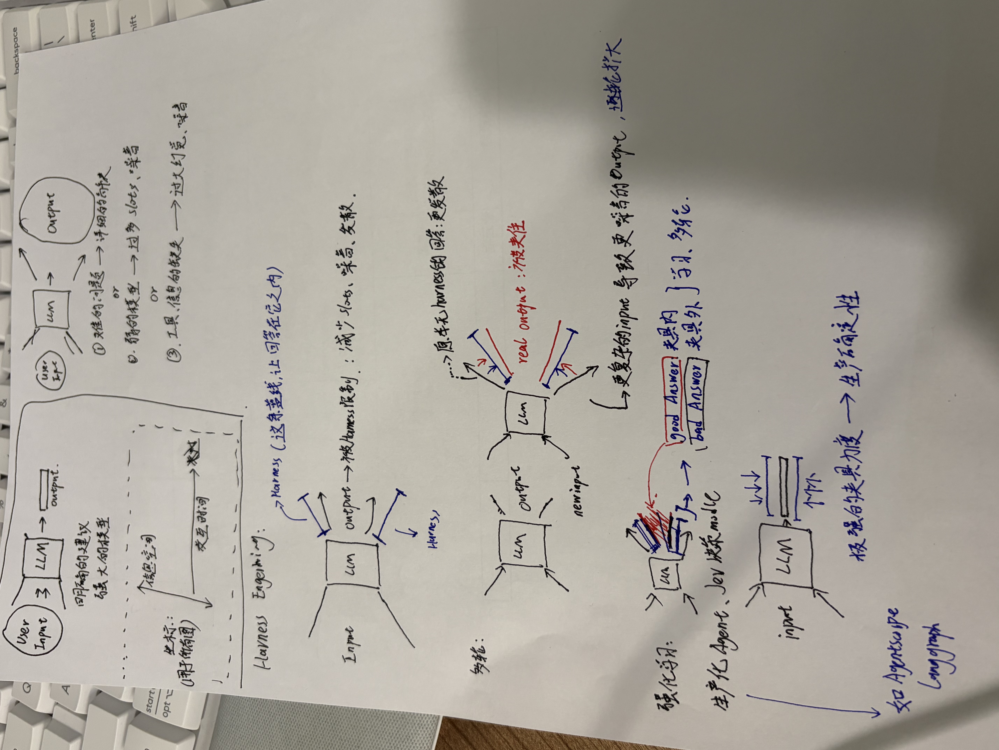
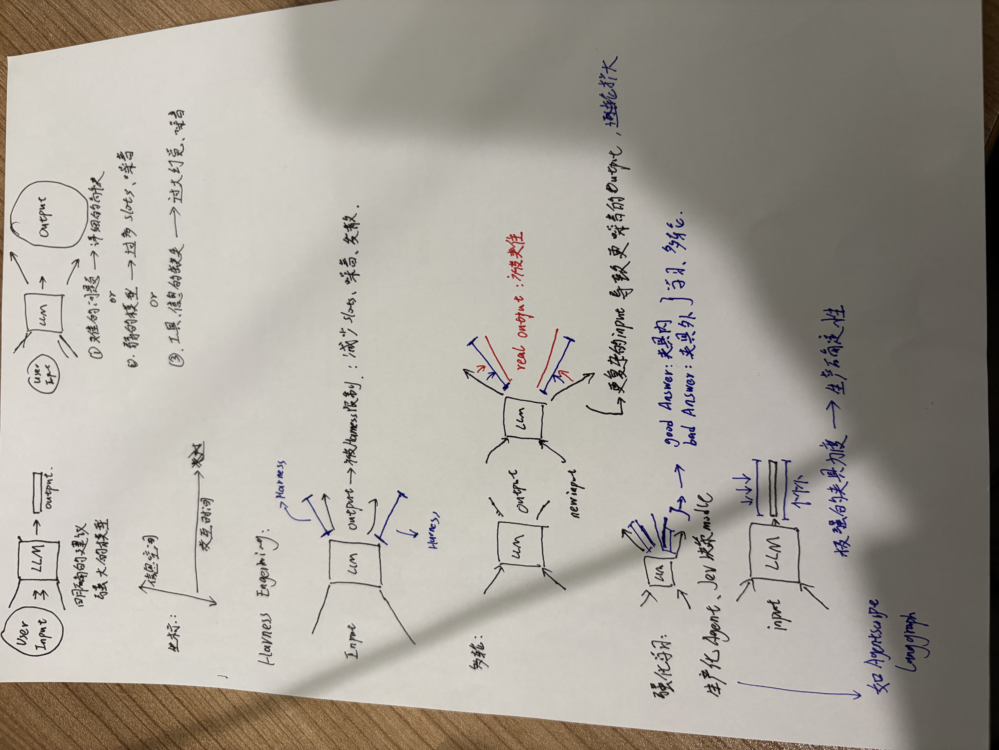

# Harness 工程 概念演示

本仓库收录 Gemini4 argon 网页、Qwen 3.8max 阿里云 Coding Plan + OpenCode、GPT 6.1sol xhigh + Codex、Kimi K3 + Workbuddy、DeepSeek V4.1 Flash 1017 Max + OpenCode 和 GPT-6 Astra + Codex 根据各版本参考图制作的 Harness 工程 HTML 演示，供在线体验和对比。仓库同时保留参考图、提示词及用量记录。

## 提示词

v2、v1 使用不同的提示图，分别见文末的 [v2 提示图](#v2-提示图)和 [v1 提示图](#v1-提示图)。

**v2：**

> 根据这张图片，做一个 harness工程的概念阐释的 html 演示，还原图片想表达的内容，可以适当扩充，并且可以先调研核对理解；我希望整体是以 LLM 输入输出图为中心的动画

**v1：**

> 根据这张图片，做一个 harness工程的概念阐释的 html 演示，还原图片想表达的内容，可以适当扩充，并且可以先调研核对理解

## 在线演示

从本次成品的整体效果来看，**v2 总体比 v1 做得更好，建议优先体验 v2**，再回看 v1 对比。

点击下方链接即可打开演示。链接指向 GitHub Pages，可直接分享给其他人。

### v2：以 LLM 输入输出图为中心的动画

第二轮更换了参考图，并在提示词中增加“整体以 LLM 输入输出图为中心的动画”。同一版本内可对比不同工具对相同提示词和参考图的呈现方式。

| 工具 | 在线演示 |
| --- | --- |
| Gemini4 argon 网页 | [打开 Gemini v2](https://matcha-eason.github.io/harness_demonstration/v2/gemini4argon-web-chat/harness_engineering.html) |
| Qwen 3.8max 阿里云 Coding Plan + OpenCode | [打开 Qwen v2](https://matcha-eason.github.io/harness_demonstration/v2/qwen38max-opencode/index.html) |
| GPT 6.1sol xhigh + Codex | [打开 Codex v2](https://matcha-eason.github.io/harness_demonstration/v2/gpt6.1sol-codex/harness-demo/dist/) |
| Kimi K3 + Workbuddy | [打开 Kimi v2](https://matcha-eason.github.io/harness_demonstration/v2/kimi-k3-workbuddy/harness-engineering.html) |
| DeepSeek V4.1 Flash 1017 Max + OpenCode | [打开 DeepSeek Flash 1017 Max v2](https://matcha-eason.github.io/harness_demonstration/v2/deepseek-flash1017-max-opencode/index.html) |
| GPT-6 Astra + Codex（日志记录 xhigh） | [打开 GPT-6 Astra v2](https://matcha-eason.github.io/harness_demonstration/v2/gpt6-astra-ultra-codex/index.html) |

2026-10-18 新增的两份成品使用同一段 v2 提示词与同一张原图。DeepSeek 版本为七章自动演示，Astra 版本为六幕交互演示。功能、时间与用量明细见 [v2 新增结果记录](v2/RESULTS.md)。Astra 目录名保留 `ultra`，对应成品会话的实际推理档位记录为 `xhigh`。

### v1：概念阐释

第一轮要求根据参考图解释 Harness 工程，还原图片想表达的内容，并允许适当扩充和调研核对理解。

| 工具 | 在线演示 |
| --- | --- |
| Gemini4 argon 网页 | [打开 Gemini v1](https://matcha-eason.github.io/harness_demonstration/v1/gemini4argon-web-chat/harness_engineering_demo.html) |
| Qwen 3.8max 阿里云 Coding Plan + OpenCode | [打开 Qwen v1](https://matcha-eason.github.io/harness_demonstration/v1/qwen38max-opencode/harness-engineering.html) |
| GPT 6.1sol xhigh + Codex | [打开 Codex v1](https://matcha-eason.github.io/harness_demonstration/v1/gpt6.1sol-codex/index.html) |
| Kimi K3 + Workbuddy | [打开 Kimi v1](https://matcha-eason.github.io/harness_demonstration/v1/kimi-k3-workbuddy/harness-engineering.html) |

## 本地查看与文件位置

下载或克隆仓库后，可用浏览器打开对应 HTML 文件。请保留演示目录内的图片等资源文件。

- `v2/`、`v1/`：两轮演示，按工具分目录存放。
- [v2 提示词](v2/prompt.txt)、[v1 提示词](v1/prompt.txt)：两轮原始要求。
- Codex v2 的可直接查看成品位于 `v2/gpt6.1sol-codex/harness-demo/dist/index.html`，同目录的 `origin.jpg` 为参考图资源。
- DeepSeek Flash 1017 Max v2 位于 [v2/deepseek-flash1017-max-opencode/index.html](v2/deepseek-flash1017-max-opencode/index.html)，保留同目录 `assets/`。[使用与统计说明](v2/deepseek-flash1017-max-opencode/README.md)。
- GPT-6 Astra v2 位于 [v2/gpt6-astra-ultra-codex/index.html](v2/gpt6-astra-ultra-codex/index.html)，原图缩略图已内嵌。[使用与统计说明](v2/gpt6-astra-ultra-codex/README.md)。
- [usage.txt](usage.txt)：原始用量记录。

## 工具用量（估算）

| 工具 | 本次记录 |
| --- | --- |
| Gemini4 argon 网页 | 两次，每次约 7–8 分钟；两次合计约占周限额 2%。网页版未显示准确耗时。 |
| Qwen 3.8max 阿里云 Coding Plan + OpenCode | 两次分别约 11、13 分钟；合计 1.26M tokens，缓存命中 88%，成本约 $0.91。 |
| GPT 6.1sol xhigh + Codex | 记录耗时约 14 分钟；第一次 1.41M tokens，缓存命中 95%，成本约 $0.54；第二次 1.56M tokens，缓存命中 95.1%，成本约 $0.50。另有一次模型容量不足提示。 |
| Kimi K3 + Workbuddy | 首次约 10 分钟、70 积分；第二次约 350 积分，多次返工，手动定位解决。 |
| DeepSeek V4.1 Flash 1017 Max + OpenCode（v2） | 30 分 7 秒；13.78M tokens，输入缓存命中 97.86%；实际费用未获取。[详细记录](v2/deepseek-flash1017-max-opencode/run.json) |
| GPT-6 Astra + Codex（v2，实际 xhigh） | 28 分 42 秒；4.09M tokens，输入缓存命中 97.38%；实际费用未获取。[详细记录](v2/gpt6-astra-ultra-codex/run.json) |

耗时、费用及额度来自本次操作的近似记录，供参考。

新增两项按产生成品的正式会话统计，包含调研、工具执行和浏览器检查；总 tokens 包含缓存输入与推理输出。Astra 用量取中止前最后一次累计报告，未重复累加累计值。早先 CLI 试跑与本次发布操作不计入这两项。首次 DeepSeek OCR 尝试的成品和记录保存在 [Git 历史](https://github.com/Matcha-Eason/harness_demonstration/tree/d1bfb6870dee581fd8667d472b2667bd5d6c95a0/v2/deepseek-flash-opencode)。

## 提示图

### v2 提示图

### v1 提示图

