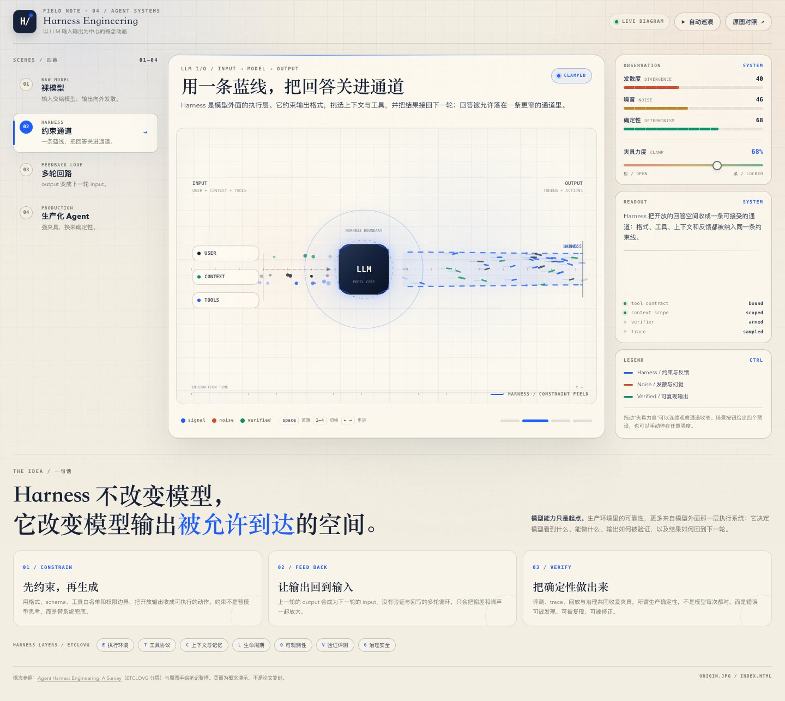

# DeepSeek Flash + OpenCode · Harness v2

沿用 [v2 原始任务](../prompt.txt)和同一张参考图，由 OpenCode 1.4.7 调用 DeepSeek 官方 API 的 `deepseek-flash` 完成。

直接用浏览器打开 [index.html](index.html)，保留同目录 `origin.jpg`。无需安装依赖或构建，样式、脚本与 Canvas 动画内置，可离线打开。

## 内容与交互

- 四个场景：裸模型、约束通道、多轮回路、生产化 Agent。
- 中央 LLM 输入输出动画，展示输入、模型、发散输出、蓝色约束通道与反馈回路。
- 夹具力度滑块联动动画、示意指标和说明。
- 自动巡演；空格播放或暂停，数字 1–4 切换场景，左右方向键步进。
- 原图对照弹窗，支持关闭按钮、Esc 和点击遮罩关闭。
- 桌面与手机布局，以及 ETCLOVG 七层概念补充。

页面中的发散度、噪音和确定性是动画预设计算的示意值，不是模型评测结果；页面不调用真实模型、执行真实验证或训练。

## 生成记录

- 模型：`deepseek-official/deepseek-flash`，端点 `https://api.deepseek.com`；未显式指定 reasoning variant。
- 会话：`ses_eb237ef42ffeGrn04CBlKBxkgU`。
- 时间：2026-10-17 23:52 至 2026-10-18 00:02（America/Los_Angeles），事件覆盖约 10.63 分钟，包含 OCR、一次权限恢复间隔和模型自行执行的浏览器验证，不含前后仓库整理。
- OpenCode 事件累计：3,047,350 tokens，其中未缓存输入 166,768、缓存读取 2,796,928、输出 37,735、推理 45,919；按输入计的缓存命中约 94.4%。各项按 OpenCode 的事件字段记录。
- 实际费用未获取；运行器在没有配置价格时返回的 `cost=0` 不作为实际费用记录。

该模型说明自己不能直接查看图片。本次由其通过 Apple Vision OCR、OCR.Space 在线 OCR 和版面／颜色分析读取参考图。因此，原始任务与参考图相同，图像读取方式有差异。

首次运行因 OpenCode 拒绝在目录外写 OCR 临时脚本而中止；随后在同一会话继续，将临时文件改放作品目录。原始提示词保存在 `prompt.txt`，实际执行指令、恢复指令与用量摘要保存在 [run.json](run.json)。

HTML 由 DeepSeek Flash 在 OpenCode 中生成并自行修正。Codex 负责运行协调、结果检查、运行记录与仓库入口整理。

## 验证

生成流程使用 Chrome 检查了桌面 1440×1000 与手机 390×844：场景切换、滑块联动、原图加载与关闭、自动巡演及推进均有执行记录，未发现 JavaScript 报错或横向溢出。

Codex 对最终文件再次检查了上述交互、数字与方向键导航、巡演暂停、脚本语法和离线加载，全部通过；加载页面时没有发起网络请求。原始提示词与参考图已逐字节核对一致。

## 概念参考

页面引用 [Agent Harness Engineering: A Survey](https://picrew.github.io/LLM-Harness/) 的 ETCLOVG 分层，并结合原始手绘图展开。
