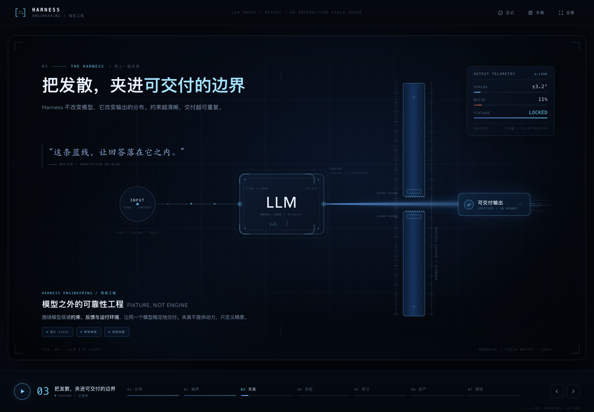

# Harness Engineering · DeepSeek Flash 1017 Max + OpenCode

打开 [index.html](index.html) 即可运行，保留同目录 `assets/origin.jpg`。页面使用原生 HTML、CSS、JavaScript 与 SVG，无须安装依赖。

## 内容与操作

七章围绕中央 LLM 输入输出图展开：分布、噪声、夹具、多轮、学习、生产、原则。支持开始演示、自动推进、播放暂停、前后章节、数字键 1–7 导航、重播、全屏，以及原图和概念注记弹窗。

原始要求保存在 `prompt.txt`，完整原图保存在 `origin.jpg`；两者与 v2 原文件一致。`assets/origin.jpg` 为页面使用的处理后图片。

动画、输出路径和任务效果为教学示意，不调用真实模型或训练服务。

## 时间与用量

- 模型：官方 API `deepseek-official/deepseek-flash`，variant `max`。
- OpenCode 会话：`ses_eb1fefe26ffeFPS7tloS3FBvL4`，会话记录版本 `1.19.1`。
- 时间：2026-10-18 00:54:42.898 至 01:24:49.987（America/Los_Angeles），**30 分 7 秒**。
- 总用量：**13,782,502 tokens**，含缓存输入和推理输出。
- 输入：13,585,184，其中缓存 13,294,336；输入缓存命中 **97.86%**。
- 输出：197,318，其中推理 140,476。
- 实际费用未获取。未配置价格时记录的 `cost=0` 不当作实际费用。

统计覆盖产生成品的正式会话，包含调研、工具循环、自动压缩、恢复和检查。原始字段及口径见 [run.json](run.json)，两份新成品的比较见 [RESULTS.md](../RESULTS.md)。

