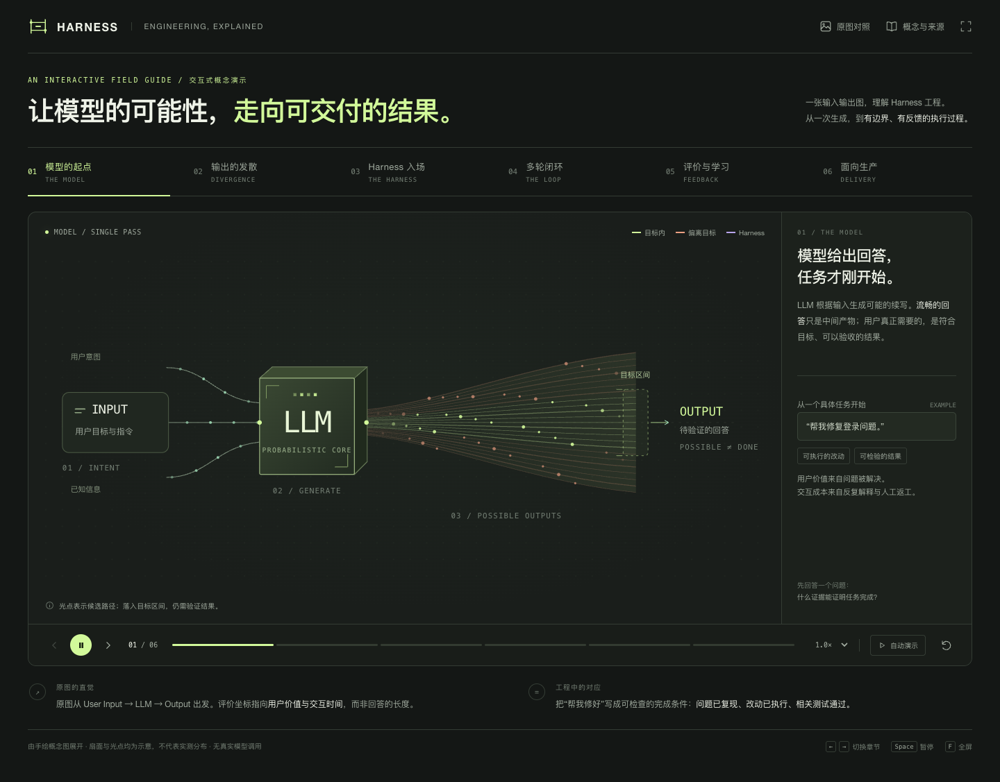

# Harness Engineering · 从生成到交付

双击 `index.html`，用浏览器打开即可。HTML 已内嵌样式、脚本和原图缩略图，支持离线使用；查看外部参考文章时需要联网。无需安装依赖，也无需 API Key。

## 演示路线

1. **模型的起点**：输入、概率生成与可验收结果。
2. **输出的发散**：任务复杂、能力不匹配、信息或工具缺失。
3. **Harness 入场**：拖动滑杆，观察约束轨道与输出扇面的变化。
4. **多轮闭环**：推进四轮，切换结果检查，比较反馈带来的影响。
5. **评价与学习**：切换运行时反馈与训练时学习，区分上下文更新和参数更新。
6. **面向生产**：模拟修复登录问题；切换上下文、工具、验证，查看交付或停止状态。

可使用“自动演示”依次播放六幕；多轮闭环、训练路径和交付流程会自动推进。动画可暂停、变速、重置和全屏。键盘 `←` / `→` 切换章节，空格暂停，`F` 全屏，`R` 重置。操作滑杆时，方向键调整滑杆数值。

## 概念与来源

`origin.jpg` 为原始手绘图，保持原文件不变。页面的“原图对照”给出六幕与手绘内容的映射；“概念与来源”列出以下资料及核对说明：

- [Anthropic: Demystifying evals for AI agents](https://www.anthropic.com/engineering/demystifying-evals-for-ai-agents)
- [Anthropic: Effective harnesses for long-running agents](https://www.anthropic.com/engineering/effective-harnesses-for-long-running-agents)
- [OpenAI: Harness engineering](https://openai.com/index/harness-engineering/)
- [Ouyang et al.: Training language models to follow instructions with human feedback](https://arxiv.org/abs/2203.02155)

扇面、光点、力度刻度和模拟任务结果都是教学示意，不是实测效果数据。运行时检查或重试不更新模型参数；强化学习属于使用奖励信号更新参数的训练过程。约束收窄不保证事实正确或任务成功。

## 实现与检查

原生 HTML / CSS / JavaScript + SVG。没有第三方运行依赖；动画使用 `requestAnimationFrame`，支持系统减少动态效果偏好。页面说明、控件和弹窗支持键盘操作。

已在浏览器检查章节切换、滑杆、多轮反馈、训练模式、模拟交付的成功与缺失条件分支，以及原图和参考资料弹窗。模拟流程不调用真实 LLM、工具或训练接口。

## 时间与用量

目录名沿用 `gpt6-astra-ultra-codex`；产生成品的正式会话实际记录为 **`gpt-6-astra` + `xhigh`**。

- Codex 会话：`01a14e03-157f-7a83-91b3-b541165327ea`，CLI `0.163.0-alpha.10.2`。
- 时间：2026-10-18 00:56:45.133 至 01:25:27.039（America/Los_Angeles），**28 分 42 秒**，结束事件为会话中止。
- 总用量：**4,093,235 tokens**。
- 输入：4,056,287，其中缓存 3,949,824；输入缓存命中 **97.38%**。
- 输出：36,948，其中推理 7,826。缓存和推理子项已包含在输入／输出与总数中。
- 实际费用未获取。

用量取中止前最后一次累计报告（01:25:16.480），不重复累加累计值；耗时包含调研、实现和浏览器检查。早先 CLI 试跑、独立审批会话与本次发布未计入。详细口径见 [run.json](run.json)，两份新成品的比较见 [RESULTS.md](../RESULTS.md)。

